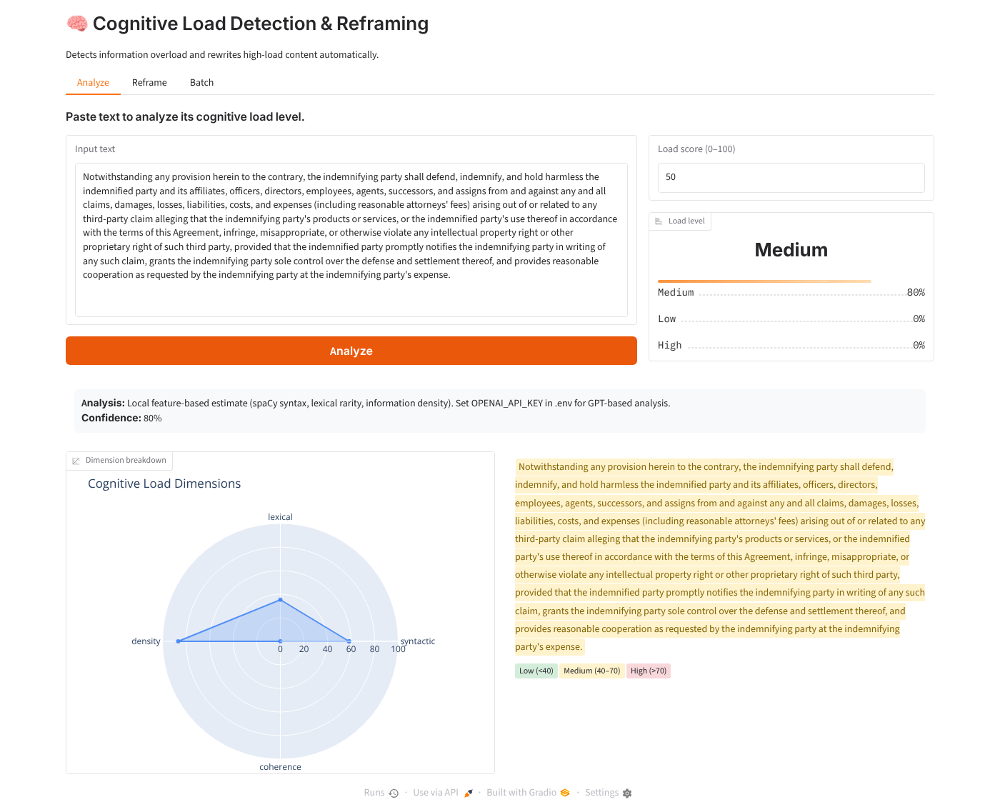
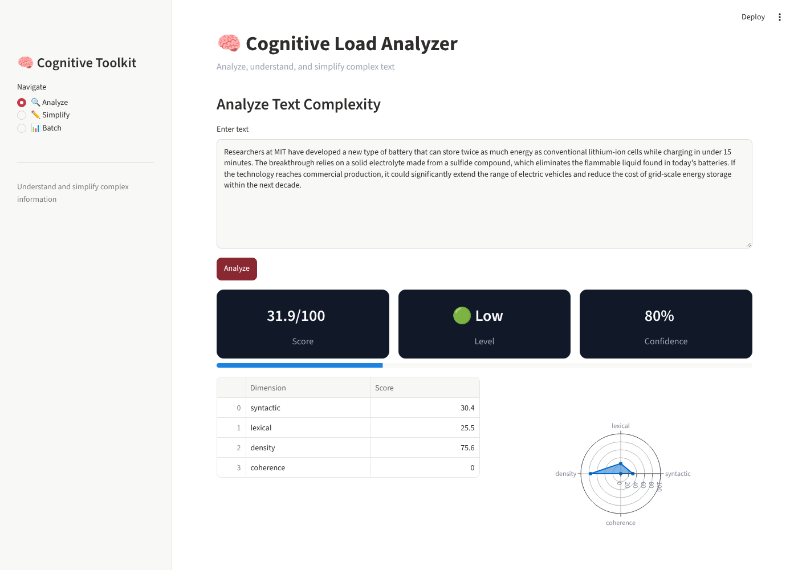
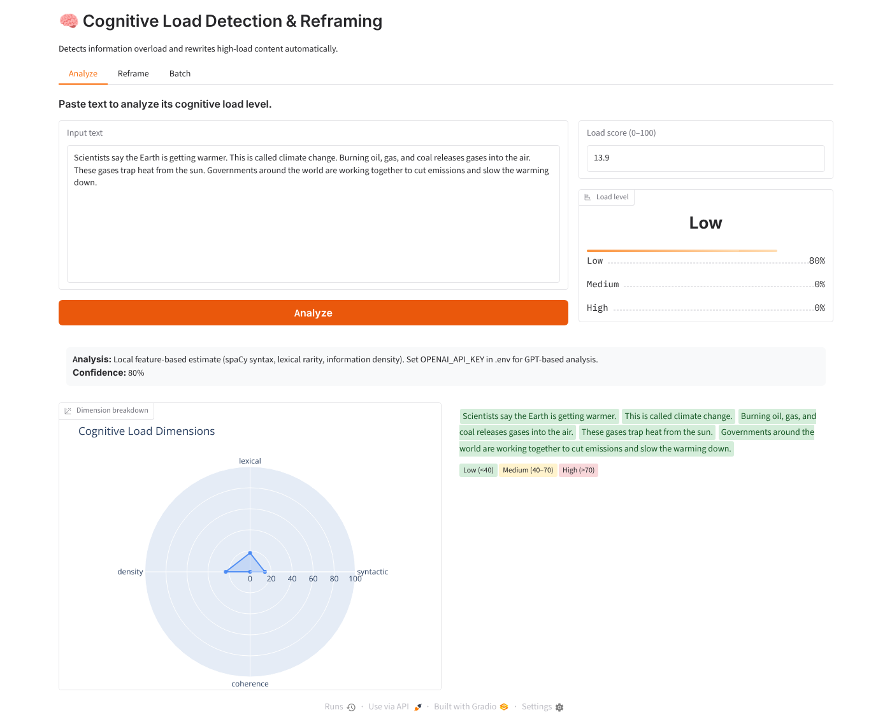
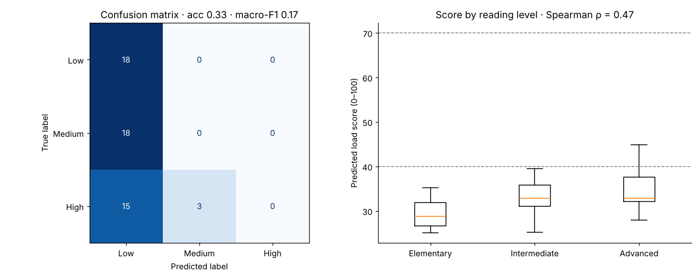

<h1 align="center">🧠 Cognitive Load Detection & Reframing System</h1>

<p align="center">
  An NLP system that measures <b>how hard a text is to process</b>, scoring it 0–100 across syntactic, lexical,<br/>
  information-density and coherence dimensions, and uses an <b>LLM to rewrite high-load text</b> into a simpler version.
</p>

<p align="center">
  
  
  
  
  
  
</p>

---

## What it does

1. Takes any input text (news, legal, medical, academic).
2. Detects cognitive load across four dimensions: **syntactic** (dependency depth, clauses, passives), **lexical** (rare words, word length, nominalisations), **information density** (entities, concepts) and **coherence** (sentence-embedding drift).
3. Outputs a **load score (0–100)**, a **label (Low / Medium / High)**, a per-dimension radar chart and **sentence-level highlighting**.
4. **Reframes** high-load text with an LLM and checks that the load dropped, using **SARI** and **BERTScore**.
5. Offers two UIs, **Streamlit** (`streamlit_app.py`) and **Gradio** (`run_app.py`), each with Analyze, Reframe/Simplify and Batch (CSV) modes.

| Analysis engine | When it is used |
|---|---|
| **GPT-4o-mini** (`src/reframing/gpt_engine.py`) | Analysis and rewriting in both UIs when `OPENAI_API_KEY` is set |
| **Local feature model** (`src/detection/predictor.py`) | Analysis with no API key: a heuristic over spaCy features, or a fine-tuned DeBERTa-v3 if `models/detector/` exists |
| **Mistral-7B** via HF API / Ollama (`src/reframing/rewriter.py`) | Alternative rewriter used by `src/pipeline/end_to_end.py` |

---

## 📸 Screenshots

**Gradio: Analyze tab with a high-load legal clause**



| Streamlit: Analyze | Gradio: low-load news text |
|---|---|
|  |  |

---

## 🚀 Setup

```bash
# 1. Clone and enter the project
git clone https://github.com/ChetanyaB/Cognitive-Load.git
cd Cognitive-Load

# 2. Create virtual environment (Python 3.13)
python -m venv venv
venv\Scripts\activate          # Windows
# source venv/bin/activate     # Mac/Linux

# 3. Install dependencies
pip install -r requirements.txt
python -m spacy download en_core_web_sm

# 4. Download OneStopEnglish (automatic)
python scripts/download_data.py

# 5. (Optional) Add CLEAR corpus
# Fill form at: https://github.com/lauramanor/clear-corpus
# Place file at: data/raw/clear.csv
# Then run:
python scripts/load_clear.py

# 6. Prepare unified dataset
python scripts/prepare_dataset.py

# 7. (Optional) add your OpenAI key for GPT analysis + rewriting
cp .env.example .env

# 8. Launch a UI (Analyze works immediately, even without an API key)
streamlit run streamlit_app.py     # Streamlit UI
python run_app.py                  # or the Gradio UI
```

## Fine-tuning (optional)

```bash
python -m src.detection.trainer --epochs 5 --batch_size 16 --output_dir models/detector/
```

## Run Tests

```bash
pip install pytest
pytest tests/                                   # 37 tests, ~10 s
python -m scripts.evaluate_model --split test --plot_dir docs/evaluation --output_json docs/evaluation/metrics_test.json
```

---

## Notes for Python 3.13 Users

- This project is built and tested on Python 3.13
- Uses `en_core_web_sm` (not `en_core_web_trf`) to avoid spacy-transformers conflicts
- SARI is implemented natively — no `easse` dependency
- All deprecated stdlib modules (audioop, distutils) are avoided

---

## Architecture

```
Input Text
    │
    ▼
Feature Extraction (syntactic + lexical + density + coherence)
    │
    ▼
Cognitive Load Predictor (DeBERTa-v3 + feature fusion, or heuristic fallback)
    │
    ▼
Load Score & Label (0–100, Low/Medium/High)
    │
    ├─ If LOW/MEDIUM → Return result
    │
    └─ If HIGH → TextRewriter (Mistral via HF API or Ollama)
                    │
                    ▼
                Candidates × 3 temperatures
                    │
                    ▼
                RewriteEvaluator (SARI + BERTScore + load delta)
                    │
                    ▼
                Best rewrite + evaluation scores
```

## Datasets

### OneStopEnglish
- Source: https://github.com/nishkalavallabhi/OneStopEnglishCorpus
- Auto-downloaded by `scripts/download_data.py`
- 3 reading levels: Elementary (load 20), Intermediate (55), Advanced (85)

### CLEAR Corpus
- Source: https://github.com/lauramanor/clear-corpus
- Requires filling a form to access
- Place downloaded CSV at `data/raw/clear.csv`
- plain documents → load 15, complex → load 80

## Models Used

- **Detection**: microsoft/deberta-v3-base (with feature fusion)
- **Coherence**: all-mpnet-base-v2 (sentence-transformers)
- **Analysis + rewriting in the UIs**: OpenAI GPT-4o-mini
- **Alternative rewriter**: mistralai/Mistral-7B-Instruct-v0.2 (via HF API or local Ollama)
- **Evaluation**: BERTScore, SARI (custom implementation)

## Environment Variables

Copy `.env.example` to `.env` and fill in your tokens:

```bash
cp .env.example .env
```

- `OPENAI_API_KEY`: OpenAI key for GPT analysis and rewriting (`OPENAI_MODEL`, default `gpt-4o-mini`)
- `HF_TOKEN`: HuggingFace token for Mistral API access
- `MODEL_NAME`: HuggingFace model ID for rewriting
- `OLLAMA_URL`: Local Ollama endpoint (auto-detected)

---

## 📊 Evaluation

**Dataset:** OneStopEnglish. Each of 189 news articles is written at three reading levels: Elementary → Low (20), Intermediate → Medium (55) and Advanced → High (85). The test split has 54 texts (18 per level). These results are for the **local feature model** (heuristic mode). No fine-tuned DeBERTa checkpoint is in the repository.

| Metric (test split) | Value |
|---|---|
| Spearman ρ (score vs. reading level) | **0.47** (validation 0.51) |
| 3-class accuracy, default thresholds (40 / 70) | 0.33 |
| Macro-F1, default thresholds | 0.17 |
| MAE vs. level score | 27.3 |
| 3-class accuracy, thresholds tuned on validation | 0.46 |



---

## ✅ Test case scenarios

37 tests (`pytest -v`): 30 original and 7 regression tests added in `tests/test_fixes.py`.

| Area | What is tested | Status |
|---|---|---|
| Features | Syntactic, lexical and density extractors return valid ranges; complex > simple text | ✅ |
| Detector | Score in 0–100, label in {Low, Medium, High}, dimensions and sentence scores present | ✅ |
| SARI / prompts | n-grams; identical text = 100; unrelated text < 30; prompt builder has rules and few-shot examples | ✅ |
| Sentence highlighting | Real per-sentence scores; one prediction < 30 s | ✅ |
| Ranking | Low demo text < Medium < High | ✅ |
| Dataset | No parse trees; 189 / 189 / 189 per level | ✅ |
| Level detection | `Printing-adv.txt` → adv (contains "int") | ✅ |
| Apps | Gradio `build_app()` returns an app; Analyze works without an API key | ✅ |

Full output: [`docs/test_results.txt`](docs/test_results.txt).

